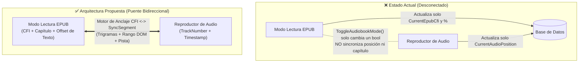
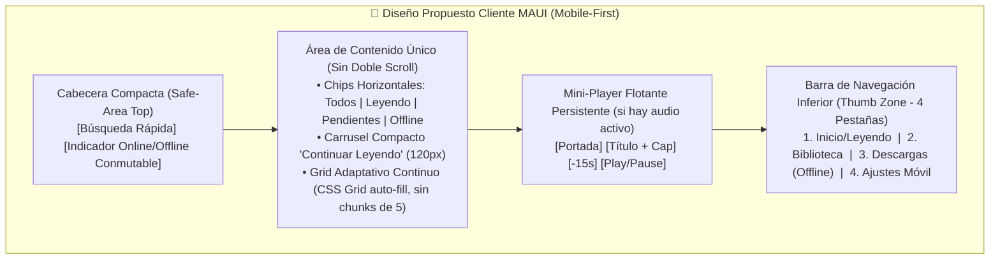

# Plan de Mejora, Optimización, Errores y Mejoras para QuimeraReader

> [!IMPORTANT]
> **Resumen Ejecutivo de la Auditoría**
> Se ha realizado una auditoría integral de código, arquitectura, flujos de datos y experiencia de usuario (UI/UX) de **QuimeraReader** abarcando el Backend (`API`, `Application`, `Domain`, `Infrastructure`), el Cliente Web (`QuimeraReader.Web`), la librería compartida (`QuimeraReader.Shared`) y el Cliente Móvil híbrido (`QuimeraReader.Mobile` en .NET MAUI).
>
> El diagnóstico revela que los problemas reportados en **lectura, marcado, continuidad audiolibro ↔ lectura, modo karaoke, escaneo/sincronización e incomodidad de la interfaz móvil** no son fallos aislados, sino el resultado de **más de 55 errores técnicos verificables** y desconexiones arquitectónicas en el código actual.

---

## Índice

1. [Auditoría de Lectura y Motor EPUB (`ReaderPlayer` + `epubInterop.js`)](#1-auditoría-de-lectura-y-motor-epub-readerplayer--epubinteropjs)
2. [Auditoría de los Distintos Tipos de Marcado y Anotaciones](#2-auditoría-de-los-distintos-tipos-de-marcado-y-anotaciones)
3. [Auditoría de Continuación Audiolibro ↔ Lectura (y Viceversa)](#3-auditoría-de-continuación-audiolibro--lectura-y-viceversa)
4. [Auditoría del Modo Karaoke y Sincronización de Audio (`SyncMap` y Whisper)](#4-auditoría-del-modo-karaoke-y-sincronización-de-audio-syncmap-y-whisper)
5. [Auditoría del Funcionamiento Interno: Escaneo, Emparejamiento y Base de Datos](#5-auditoría-del-funcionamiento-interno-escaneo-emparejamiento-y-base-de-datos)
6. [Auditoría del Cliente Web y del Cliente MAUI (Sincronización Offline y Duplicación)](#6-auditoría-del-cliente-web-y-del-cliente-maui-sincronización-offline-y-duplicación)
7. [Auditoría UX/UI y Propuesta de Rediseño Especial para el Cliente MAUI (Mobile-First)](#7-auditoría-uxui-y-propuesta-de-rediseño-especial-para-el-cliente-maui-mobile-first)
8. [Higiene del Repositorio y Deuda Técnica](#8-higiene-del-repositorio-y-deuda-técnica)
9. [Hoja de Ruta de Implementación (Plan de Acción por Fases)](#9-hoja-de-ruta-de-implementación-plan-de-acción-por-fases)

---

## 1. Auditoría de Lectura y Motor EPUB (`ReaderPlayer` + `epubInterop.js`)

El motor de lectura reside en [ReaderPlayer.razor](file:///c:/Users/tomas/Desktop/Proyectos/QuimeraReader/QuimeraReader.Clients/QuimeraReader.Shared/Components/ReaderPlayer.razor) y [epubInterop.js](file:///c:/Users/tomas/Desktop/Proyectos/QuimeraReader/QuimeraReader.Clients/QuimeraReader.Shared/wwwroot/epubInterop.js). Actualmente presenta fallos severos en navegación táctil/ratón, cálculo de páginas, guardado de progreso y estilos.

### 1.1. Fallo grave al pasar de página por clic/toque (`event.screenX` vs `window.innerWidth`)
- **Ubicación:** [epubInterop.js](file:///c:/Users/tomas/Desktop/Proyectos/QuimeraReader/QuimeraReader.Clients/QuimeraReader.Shared/wwwroot/epubInterop.js#L164-L232)
- **Causa raíz:** En los eventos `touchend` (línea 174) y `mouseup` (línea 190), el código captura `event.changedTouches[0].screenX` y `event.screenX`. La propiedad `screenX` devuelve la coordenada horizontal respecto al **monitor físico completo**, no respecto a la ventana ni al `iframe` del EPUB. Luego, en las líneas 228-230, compara ese valor contra `window.innerWidth`:
  ```javascript
  const screenWidth = window.innerWidth;
  if (endX < screenWidth * 0.22) rendition.prev();
  else if (endX > screenWidth * 0.78) rendition.next();
  ```
- **Consecuencia:**
  - En PC (si la ventana del navegador no está maximizada en el borde izquierdo o está en un segundo monitor), `screenX` es mucho mayor que `window.innerWidth * 0.78`. Hacer clic en el margen **izquierdo** para retroceder página evalúa `endX > screenWidth * 0.78` como verdadero y **avanza a la página siguiente en lugar de retroceder**.
  - Además, si el usuario suelta el botón del ratón fuera del `iframe`, el evento `mouseup` no se dispara y `isDragging` queda permanentemente en `true`.
- **Solución:** Usar `event.clientX` (o calcular la posición relativa al contenedor del `iframe` / `window.epubRendition`) y registrar `mouseup` a nivel de `window`.

### 1.2. Sobrescritura del progreso de lectura al abrir el libro (`0%` / Inicio)
- **Ubicación:** [epubInterop.js](file:///c:/Users/tomas/Desktop/Proyectos/QuimeraReader/QuimeraReader.Clients/QuimeraReader.Shared/wwwroot/epubInterop.js#L72-L100), [epubInterop.js](file:///c:/Users/tomas/Desktop/Proyectos/QuimeraReader/QuimeraReader.Clients/QuimeraReader.Shared/wwwroot/epubInterop.js#L153-L155) y [`OnEpubLocationChanged`](file:///c:/Users/tomas/Desktop/Proyectos/QuimeraReader/QuimeraReader.Clients/QuimeraReader.Shared/Components/ReaderPlayer.razor#L514-L540)
- **Causa raíz:** `rendition.display(lastCfi || undefined)` dispara inmediatamente el evento `rendition.on("relocated")`. Mientras `book.locations.generate(1600)` aún se está ejecutando asíncronamente, `book.locations.total` es `0` y envía `percentage = -1`. Peor aún: si un libro tenía progreso guardado por audiolibro (o desde Hardcover) pero no tenía `CurrentEpubCfi`, `rendition.display(undefined)` abre la portada, genera las ubicaciones y **sobrescribe inmediatamente `PercentageCompleted` en la base de datos con `0%`**.
- **Solución:** Ignorar el evento `relocated` inicial hasta que la restauración de posición (por CFI, por tiempo de audio o por `PercentageCompleted`) se haya completado. Si `CurrentEpubCfi` es nulo pero `PercentageCompleted > 0`, posicionar el EPUB usando `book.locations.cfiFromPercentage(PercentageCompleted / 100)`.

### 1.3. Paginación irreal y ocultamiento de página en el inicio del libro
- **Ubicación:** [epubInterop.js](file:///c:/Users/tomas/Desktop/Proyectos/QuimeraReader/QuimeraReader.Clients/QuimeraReader.Shared/wwwroot/epubInterop.js#L134-L138) y [ReaderPlayer.razor](file:///c:/Users/tomas/Desktop/Proyectos/QuimeraReader/QuimeraReader.Clients/QuimeraReader.Shared/Components/ReaderPlayer.razor#L132-L133) ([L530-L531](file:///c:/Users/tomas/Desktop/Proyectos/QuimeraReader/QuimeraReader.Clients/QuimeraReader.Shared/Components/ReaderPlayer.razor#L530-L531))
- **Causa raíz:**
  1. `book.locations.locationFromCfi(location.start.cfi)` devuelve un índice base 0 de fragmentos sintéticos de 1600 caracteres, no páginas reales de pantalla.
  2. En la primera ubicación del libro devuelve `0`. En `ReaderPlayer.razor:531`, la condición `if (currentPage > 0)` impide actualizar `_currentPage` y `_totalPages` cuando el índice es `0`, ocultando el contador de páginas al principio del libro.
  3. Al cambiar el tamaño de fuente (`setFontSize`), el número de páginas en pantalla cambia, pero los índices de 1600 caracteres permanecen estáticos.

### 1.4. Barra de progreso (`Slider`) con rebotes visuales y llamadas fuera de hilo
- **Ubicación:** [ReaderPlayer.razor](file:///c:/Users/tomas/Desktop/Proyectos/QuimeraReader/QuimeraReader.Clients/QuimeraReader.Shared/Components/ReaderPlayer.razor#L135-L142) y [`OnProgressSliderInput`](file:///c:/Users/tomas/Desktop/Proyectos/QuimeraReader/QuimeraReader.Clients/QuimeraReader.Shared/Components/ReaderPlayer.razor#L711-L751)
- **Causa raíz:** Mientras el usuario arrastra el `<input type="range">`, `OnProgressSliderInput` lanza un `Task.Run` en segundo plano que llama a `goToPercentage` sin `InvokeAsync`. Eso provoca que `epub.js` dispare `relocated` → `OnEpubLocationChanged` → `StateHasChanged()` en mitad del arrastre, haciendo que el control deslizante salte o parpadee. Además, si el navegador móvil no dispara `onchange` al soltar fuera del control, `_isDraggingProgress` queda en `true` para siempre.

### 1.5. Conflictos de CSS, variable `--bg-body` inexistente y no persistencia de preferencias
- **Ubicación:** [ReaderPlayer.razor](file:///c:/Users/tomas/Desktop/Proyectos/QuimeraReader/QuimeraReader.Clients/QuimeraReader.Shared/Components/ReaderPlayer.razor#L27), [Web/wwwroot/css/app.css](file:///c:/Users/tomas/Desktop/Proyectos/QuimeraReader/QuimeraReader.Clients/QuimeraReader.Web/wwwroot/css/app.css#L382-L389), [Mobile/wwwroot/app.css](file:///c:/Users/tomas/Desktop/Proyectos/QuimeraReader/QuimeraReader.Clients/QuimeraReader.Mobile/wwwroot/app.css#L382-L389)
- **Causa raíz:**
  - `ReaderPlayer.razor:27` usa `background: var(--bg-body);`, variable que **no está definida** en `app.css`.
  - `.text-container` (`app.css:382-389`) aplica `padding: 40px; font-size: 1.6rem; line-height: 2; overflow-y: auto;` al contenedor padre de `#epub-viewer`, robando `80px` de ancho y `80px` de alto en pantallas móviles y creando conflictos de scroll con el `iframe` de `epub.js`.
  - El tema del lector (`_currentTheme`: oscuro/claro/sepia) y el tamaño de fuente (`_fontSize`) en [ReaderPlayer.razor](file:///c:/Users/tomas/Desktop/Proyectos/QuimeraReader/QuimeraReader.Clients/QuimeraReader.Shared/Components/ReaderPlayer.razor#L281-L282) **no se guardan en `localStorage` ni en `Preferences`**, reiniciándose cada vez que el usuario abre un libro.

---

## 2. Auditoría de los Distintos Tipos de Marcado y Anotaciones

El usuario reporta fallos con los distintos tipos de marcado y lectura tras marcar. El análisis del código demuestra **6 bugs directos** en el sistema de anotaciones:

### 2.1. El 5º tipo de marcado ("Sin color / Solo subrayado") no funciona si no lleva nota de texto
- **Ubicación:** [ReaderPlayer.razor](file:///c:/Users/tomas/Desktop/Proyectos/QuimeraReader/QuimeraReader.Clients/QuimeraReader.Shared/Components/ReaderPlayer.razor#L187), [`SaveAnnotationAsync`](file:///c:/Users/tomas/Desktop/Proyectos/QuimeraReader/QuimeraReader.Clients/QuimeraReader.Shared/Components/ReaderPlayer.razor#L666-L680) y [`applyAnnotation`](file:///c:/Users/tomas/Desktop/Proyectos/QuimeraReader/QuimeraReader.Clients/QuimeraReader.Shared/wwwroot/epubInterop.js#L313-L325)
- **Causa raíz:**
  En la interfaz ([ReaderPlayer.razor:183-187](file:///c:/Users/tomas/Desktop/Proyectos/QuimeraReader/QuimeraReader.Clients/QuimeraReader.Shared/Components/ReaderPlayer.razor#L183-L187)) se ofrecen 5 opciones: Amarillo (`#ffeb3b`), Verde (`#4caf50`), Azul (`#2196f3`), Rojo (`#f44336`) y un círculo discontinuo con el título `"Sin color (Solo subrayado)"` que asigna `_selectedColor = ""`.
  Sin embargo, al pulsar "Guardar" en [`SaveAnnotationAsync`](file:///c:/Users/tomas/Desktop/Proyectos/QuimeraReader/QuimeraReader.Clients/QuimeraReader.Shared/Components/ReaderPlayer.razor#L674):
  ```csharp
  if (string.IsNullOrEmpty(color) && !hasNote && !_editingAnnotationId.HasValue) 
      return;
  ```
  ¡Si el usuario elige **"Sin color (Solo subrayado)"** sin escribir una nota, el método **sale inmediatamente sin guardar ni dibujar nada**!
  Además, en [epubInterop.js:319-322](file:///c:/Users/tomas/Desktop/Proyectos/QuimeraReader/QuimeraReader.Clients/QuimeraReader.Shared/wwwroot/epubInterop.js#L319-L322):
  ```javascript
  if (hasNote) {
      var underlineColor = (color && color.length > 0) ? color : "#ffffff";
      window.epubRendition.annotations.underline(cfiRange, {}, (e) => {}, "", {"stroke": underlineColor, ...});
  }
  ```
  - `epubInterop.js` **solo dibuja el subrayado (`underline`) si `hasNote` es `true`**.
  - Si se edita una anotación existente cambiándola a `"Sin color"` y sin nota, `ReaderPlayer.razor:671` borra la marca visual del EPUB, no dibuja nada nuevo (`L677`) y guarda en la base de datos una anotación fantasma invisible (`color = ""`, `note = ""`).
  - Peor aún: cuando sí tiene nota pero no tiene color (`color = ""`), `underlineColor` toma el valor `"#ffffff"` (**blanco puro**), por lo que en los temas **Claro (`#ffffff`)** y **Sepia (`#f4ecd8`)** el subrayado es **totalmente invisible**.

### 2.2. Crear o cerrar una anotación bloquea para siempre el paso de página (Selección fantasma)
- **Ubicación:** [epubInterop.js](file:///c:/Users/tomas/Desktop/Proyectos/QuimeraReader/QuimeraReader.Clients/QuimeraReader.Shared/wwwroot/epubInterop.js#L142-L151), [`handleSwipe`](file:///c:/Users/tomas/Desktop/Proyectos/QuimeraReader/QuimeraReader.Clients/QuimeraReader.Shared/wwwroot/epubInterop.js#L200-L210) y [`SaveAnnotationAsync` / `CloseAnnotationDialog`](file:///c:/Users/tomas/Desktop/Proyectos/QuimeraReader/QuimeraReader.Clients/QuimeraReader.Shared/Components/ReaderPlayer.razor#L588-L593)
- **Causa raíz:**
  Cuando el usuario selecciona texto en el EPUB, se abre el diálogo de anotación. Ni al guardar (`SaveAnnotationAsync`) ni al cancelar (`CloseAnnotationDialog`) se limpia la selección activa del DOM dentro del `iframe` (`contents[0].window.getSelection().removeAllRanges()`).
  Acto seguido, cuando el usuario intenta pasar de página, [`handleSwipe`](file:///c:/Users/tomas/Desktop/Proyectos/QuimeraReader/QuimeraReader.Clients/QuimeraReader.Shared/wwwroot/epubInterop.js#L200-L210) ejecuta:
  ```javascript
  const selection = contents[0].window.getSelection();
  if (selection && selection.toString().trim().length > 0) {
      isTextSelected = true;
  }
  if (isTextSelected) return;
  ```
  Como el texto sigue seleccionado en el `iframe`, **`handleSwipe` aborta todos los toques y deslizamientos**, dejando el lector bloqueado sin poder pasar de página hasta que el usuario adivine que debe tocar en medio del texto para quitar la selección.

### 2.3. Condición de carrera al cargar las anotaciones al abrir el libro
- **Ubicación:** [ReaderPlayer.razor](file:///c:/Users/tomas/Desktop/Proyectos/QuimeraReader/QuimeraReader.Clients/QuimeraReader.Shared/Components/ReaderPlayer.razor#L481-L498) y [`applyAllAnnotations`](file:///c:/Users/tomas/Desktop/Proyectos/QuimeraReader/QuimeraReader.Clients/QuimeraReader.Shared/wwwroot/epubInterop.js#L336-L359)
- **Causa raíz:** Tras llamar a `initializeEpub`, se lanza un `Task.Run` sin esperar a que `rendition.display()` termine de montar la vista del capítulo. Si `applyAllAnnotations` se ejecuta antes de que la sección esté renderizada o al cambiar de capítulo, `epub.js` no muestra los trazos SVG o los duplica sin limpiarlos.

### 2.4. Clicar sobre una anotación en los márgenes pasa la página al mismo tiempo
- **Ubicación:** [epubInterop.js](file:///c:/Users/tomas/Desktop/Proyectos/QuimeraReader/QuimeraReader.Clients/QuimeraReader.Shared/wwwroot/epubInterop.js#L180-L232) y [L246-L250](file:///c:/Users/tomas/Desktop/Proyectos/QuimeraReader/QuimeraReader.Clients/QuimeraReader.Shared/wwwroot/epubInterop.js#L246-L250)
- **Causa raíz:** Al tocar un resaltado (`markClicked`), también se dispara `touchend`/`mouseup` en el `rendition`. Si la palabra marcada está en el 22% izquierdo o derecho (o si ocurre el bug de `screenX` de la sección 1.1), el lector **pasa de página al mismo tiempo que abre el modal de edición de la anotación**.

### 2.5. Conflicto entre selección táctil y swipe en móvil + Fuga del candado de navegación
- **Ubicación:** [ReaderPlayer.razor](file:///c:/Users/tomas/Desktop/Proyectos/QuimeraReader/QuimeraReader.Clients/QuimeraReader.Shared/Components/ReaderPlayer.razor#L259-L267) y [epubInterop.js](file:///c:/Users/tomas/Desktop/Proyectos/QuimeraReader/QuimeraReader.Clients/QuimeraReader.Shared/wwwroot/epubInterop.js#L280-L298)
- **Causa raíz:** En móvil, al arrastrar el dedo o los manipuladores de selección horizontalmente más de `45px`, `touchend` detecta `absDiffX > 45` y pasa de página antes de que Android confirme la selección. Además, el botón de bloqueo (`window.navigationLocked`) **no se resetea en `destroyEpub()`**, por lo que si el usuario bloquea la navegación en un libro, sale y abre otro libro, el nuevo libro muestra el candado desbloqueado en la UI (`_isNavigationLocked = false`) pero tiene la navegación bloqueada en JS (`window.navigationLocked = true`).

### 2.6. Fallo de edición/borrado de anotaciones en modo Offline y vulnerabilidad en API
- **Ubicación:** [`BookService.cs`](file:///c:/Users/tomas/Desktop/Proyectos/QuimeraReader/QuimeraReader.Clients/QuimeraReader.Shared/Services/BookService.cs#L374-L387), [`LocalBookRepository.cs`](file:///c:/Users/tomas/Desktop/Proyectos/QuimeraReader/QuimeraReader.Clients/QuimeraReader.Mobile/Data/LocalBookRepository.cs#L239-L247), [`WebOfflineSyncWorker.cs`](file:///c:/Users/tomas/Desktop/Proyectos/QuimeraReader/QuimeraReader.Clients/QuimeraReader.Web/Services/WebOfflineSyncWorker.cs#L95-L149) y [`BooksController.cs`](file:///c:/Users/tomas/Desktop/Proyectos/QuimeraReader/QuimeraReader.API/Controllers/BooksController.cs#L959-L1003)
- **Causa raíz:**
  1. Las anotaciones creadas offline se guardan en una cola con `Id = 0`. Cuando el usuario las toca para editarlas o borrarlas, `BookService.UpdateAnnotationAsync` y `DeleteAnnotationAsync` **no tienen soporte offline**: llaman directamente a `PUT / DELETE api/Books/{id}/annotations/0`, fallando por red o recibiendo `404 Not Found`.
  2. En Web, `WebOfflineSyncWorker.SyncDownToLocalAsync` nunca descarga las anotaciones existentes del servidor.
  3. En `BooksController.cs:994-1003`, `UpdateAnnotation` no actualiza `annotation.UpdatedAt = DateTime.UtcNow`.

---

## 3. Auditoría de Continuación Audiolibro ↔ Lectura (y Viceversa)

El usuario destaca que **la continuación del audiolibro a la lectura y viceversa no funciona**. La auditoría confirma que **actualmente no existe sincronización automática bidireccional entre la posición del audio y la posición del texto EPUB**.



### 3.1. Desconexión total entre `CurrentAudioPosition` y `CurrentEpubCfi`
- **Ubicación:** [`ToggleAudiobookMode`](file:///c:/Users/tomas/Desktop/Proyectos/QuimeraReader/QuimeraReader.Clients/QuimeraReader.Shared/Components/ReaderPlayer.razor#L269-L273), [`OnEpubLocationChanged`](file:///c:/Users/tomas/Desktop/Proyectos/QuimeraReader/QuimeraReader.Clients/QuimeraReader.Shared/Components/ReaderPlayer.razor#L514-L540) y [`OnTimeUpdate`](file:///c:/Users/tomas/Desktop/Proyectos/QuimeraReader/QuimeraReader.Clients/QuimeraReader.Shared/Components/ReaderPlayer.razor#L757-L789)
- **Qué ocurre al pasar de Audiolibro → Lectura:**
  1. Mientras el usuario escucha el audiolibro, `OnTimeUpdate` ([ReaderPlayer.razor:765-767](file:///c:/Users/tomas/Desktop/Proyectos/QuimeraReader/QuimeraReader.Clients/QuimeraReader.Shared/Components/ReaderPlayer.razor#L765-L767)) guarda únicamente `audioPosition` y `audioTrackNumber`, dejando un comentario explícito en el código:
     `// Solo mandamos el audioPosition, dejamos el epubCfi intacto o null.`
  2. Cuando el usuario pulsa el botón para cambiar de vista de audiolibro a lectura (`ToggleAudiobookMode` en la línea 269):
     ```csharp
     private void ToggleAudiobookMode()
     {
         _showAudiobookMode = !_showAudiobookMode;
         StateHasChanged();
     }
     ```
     **Solo invierte un booleano.** No busca en qué segmento (`_segments`) está el audio actual (`_currentTime`), ni navega el EPUB (`rendition.display(cfi)`) a ese punto, ni redimensiona el `iframe` de `epub.js` tras haber estado oculto con `display: none`. El lector EPUB simplemente reaparece en la página antigua donde estaba horas o días atrás.
- **Qué ocurre al pasar de Lectura → Audiolibro:**
  1. Mientras el usuario lee y pasa páginas en el EPUB, `OnEpubLocationChanged` actualiza `CurrentEpubCfi` y `PercentageCompleted`, pero **jamás actualiza `CurrentAudioPosition` ni busca el timestamp correspondiente en `_segments`**.
  2. Si el usuario avanza 50 páginas leyendo y pulsa *Play* en el reproductor de audio (o cambia a modo audiolibro), el audio **empieza a sonar desde donde se quedó el audio la última vez**, ignorando por completo las 50 páginas leídas.

### 3.2. El botón manual "Fijar Audio" / "Reproducir" (`SetAudioBookmarkAsync`) salta al capítulo equivocado
- **Ubicación:** [`SetAudioBookmarkAsync`](file:///c:/Users/tomas/Desktop/Proyectos/QuimeraReader/QuimeraReader.Clients/QuimeraReader.Shared/Components/ReaderPlayer.razor#L595-L635)
- **Causa raíz:** Cuando el usuario selecciona una frase del libro y pulsa *"Reproducir"* o *"Fijar Audio"*, el código ejecuta (líneas 600-604):
  ```csharp
  var searchStr = new string(_selectedText.ToLower().Where(c => char.IsLetterOrDigit(c)).ToArray());
  var match = _segments.FirstOrDefault(s => {
      var sText = new string(s.Text.ToLower().Where(c => char.IsLetterOrDigit(c)).ToArray());
      return sText.Contains(searchStr) || searchStr.Contains(sText);
  });
  ```
  1. **Falso positivo crítico (`searchStr.Contains(sText)`):** Los segmentos de Whisper (`_segments`) contienen a menudo frases cortas como `"Sí."` (`sText = "si"`), `"No."` (`"no"`), `"Él"` (`"el"`), o `"Y"` (`"y"`). Si el usuario selecciona una frase larga en el Capítulo 15 (ej. *"Cuando llegó a la casa, él dijo que sí"*), `FirstOrDefault` recorre desde el minuto 0:00 del Capítulo 1 y encuentra el primer segmento corto `"Sí."` porque `"cuandollegoalacasaeldijoquesi".Contains("si")` es `true`. **El audio salta inmediatamente al Capítulo 1 en lugar del Capítulo 15.**
  2. **Fallo entre dos segmentos:** Si la selección del usuario abarca el final de un segmento de Whisper y el principio del siguiente, ningún segmento individual contiene toda la cadena `searchStr`, devolviendo `"No se encontró el audio para este fragmento"`.
  3. **No guarda en base de datos:** Cuando se llama con `autoPlay: false` ("Fijar Audio"), modifica `_currentTime` en memoria pero **no llama a `BookService.UpdatePositionAsync`**, perdiendo el marcador si se cierra el libro.

### 3.3. `convertKaraokeToHardMark()` al pausar el audio nunca funciona (`window.lastKaraokeCfi` no existe)
- **Ubicación:** [`OnPlayStateChanged`](file:///c:/Users/tomas/Desktop/Proyectos/QuimeraReader/QuimeraReader.Clients/QuimeraReader.Shared/Components/ReaderPlayer.razor#L805-L817) y [`convertKaraokeToHardMark`](file:///c:/Users/tomas/Desktop/Proyectos/QuimeraReader/QuimeraReader.Clients/QuimeraReader.Shared/wwwroot/epubInterop.js#L452-L465)
- **Causa raíz:** Al pausar el audio, Blazor invoca `convertKaraokeToHardMark()` con la intención de convertir la frase actual del karaoke en una marca visual naranja (`setAudioBookmark`) dentro del EPUB:
  ```javascript
  export function convertKaraokeToHardMark() {
      if (!window.epubRendition) return;
      if (window.lastKaraokeCfi) {
          setAudioBookmark(window.lastKaraokeCfi);
      }
      ...
  ```
  **`window.lastKaraokeCfi` no se asigna en ninguna línea de todo el proyecto.** Por tanto, `if (window.lastKaraokeCfi)` es siempre `undefined`, y pausar el audiolibro simplemente borra el resaltado amarillo sin dejar ninguna marca ni guardar el CFI actual.

### 3.4. Pérdida de progreso y de pista (`TrackNumber`) en audiolibros multipista
- **Ubicación:** [ReaderPlayer.razor](file:///c:/Users/tomas/Desktop/Proyectos/QuimeraReader/QuimeraReader.Clients/QuimeraReader.Shared/Components/ReaderPlayer.razor#L373-L385), [L425-L431](file:///c:/Users/tomas/Desktop/Proyectos/QuimeraReader/QuimeraReader.Clients/QuimeraReader.Shared/Components/ReaderPlayer.razor#L425-L431) y [`DisposeAsync`](file:///c:/Users/tomas/Desktop/Proyectos/QuimeraReader/QuimeraReader.Clients/QuimeraReader.Shared/Components/ReaderPlayer.razor#L832-L835)
- **Causa raíz:**
  1. En `DisposeAsync()` (línea 832):
     ```csharp
     if (Book != null && !string.IsNullOrEmpty(Book.CurrentEpubCfi))
     {
         await BookService.UpdatePositionAsync(BookId, epubCfi: Book.CurrentEpubCfi, audioPosition: _currentTime, percentage: Book.PercentageCompleted);
     }
     ```
     No envía `audioTrackNumber: _currentTrackNumber` al cerrar el lector, y si el libro se estaba escuchando sin `CurrentEpubCfi`, ni siquiera entra en el `if`.
  2. Al abrir un libro cuya pista guardada es la pista 3 (`CurrentAudioTrackNumber = 3`), el primer render carga la URL de la pista 1 (`_currentTrackNumber = 1`). En `OnAfterRenderAsync` cambia a la pista 3, espera solo `50ms` (`Task.Delay(50)`) e intenta hacer `seekAudio` antes de que el elemento `<audio>` haya cargado los metadatos de la nueva pista, provocando que el tiempo se reinicie a `0:00`.

---

## 4. Auditoría del Modo Karaoke y Sincronización de Audio (`SyncMap` y Whisper)

El modo Karaoke falla tanto en el **Frontend** (manipulación del DOM de `epub.js`) como en el **Backend** (generación incompleta del `SyncMap` con Whisper).

### 4.1. Resalta todo el párrafo `<p>` o `<div>` en lugar de la frase pronunciada
- **Ubicación:** [`highlightKaraokePhrase`](file:///c:/Users/tomas/Desktop/Proyectos/QuimeraReader/QuimeraReader.Clients/QuimeraReader.Shared/wwwroot/epubInterop.js#L390-L428)
- **Causa raíz:** El buscador recorre nodos de texto (`NodeFilter.SHOW_TEXT`), pero cuando encuentra el nodo `bestMatch`, aplica la clase `.karaoke-highlight` y el fondo amarillo a `bestMatch.parentElement` (líneas 416-420):
  ```javascript
  var targetEl = bestMatch.parentElement;
  targetEl.classList.add('karaoke-highlight');
  targetEl.style.backgroundColor = 'rgba(255, 193, 7, 0.45)';
  ```
  En un EPUB, el padre de un nodo de texto es el párrafo completo `<p>` (que puede tener 15 líneas). En vez de envolver el rango de texto exacto (`Range` / `epubRendition.annotations.highlight(cfiRange)`), colorea todo el bloque HTML.

### 4.2. Coincidencia errónea de texto en el DOM y rotura con etiquetas inline (`<em>`, `<span>`)
- **Ubicación:** [`highlightKaraokePhrase`](file:///c:/Users/tomas/Desktop/Proyectos/QuimeraReader/QuimeraReader.Clients/QuimeraReader.Shared/wwwroot/epubInterop.js#L395-L413)
- **Causa raíz:**
  1. Evalúa `if (normNodeText.includes(searchStr) || searchStr.includes(normNodeText))` recorriendo el capítulo desde el principio (`doc.body`). Si al inicio del capítulo hay un nodo corto de `>= 4` letras (por ejemplo `<em>casa</em>` o un subtítulo corto) y más adelante el narrador lee una frase larga que contiene esas 4 letras, `searchStr.includes(normNodeText)` da positivo en el nodo del principio del capítulo y detiene la búsqueda (`break`).
  2. Si una frase en el EPUB contiene cursivas o negritas (`<p>Él dijo <em>hola</em> a todos</p>`), el DOM la divide en 3 nodos de texto separados. Como el `TreeWalker` evalúa cada nodo por separado contra los primeros 25 caracteres de `searchStr`, **nunca hace match en frases con formato inline**.

### 4.3. `targetEl.scrollIntoView()` rompe la maquetación paginada de `epub.js` y nunca pasa de página ni de capítulo
- **Ubicación:** [epubInterop.js](file:///c:/Users/tomas/Desktop/Proyectos/QuimeraReader/QuimeraReader.Clients/QuimeraReader.Shared/wwwroot/epubInterop.js#L424-L426)
- **Causa raíz:**
  `epub.js` renderiza el libro en modo paginado (`flow: "paginated"`) mediante columnas CSS horizontales dentro de un `iframe`. Cuando `highlightKaraokePhrase` llama a `targetEl.scrollIntoView({ behavior: 'smooth', block: 'center' })`:
  1. Desplaza el scroll nativo del `iframe` a una posición intermedia entre dos columnas, dejando **páginas cortadas por la mitad** en pantalla.
  2. Desincroniza el estado interno de `rendition.location` en `epub.js`.
  3. Si el audio avanza a la página siguiente o al siguiente archivo XHTML del EPUB (siguiente capítulo), como nunca se calcula el CFI del nodo ni se invoca `rendition.display(cfi)`, **el lector jamás pasa de página ni cambia de capítulo automáticamente durante el Karaoke**.

### 4.4. El Backend solo transcribe la Pista 1 (`FirstOrDefault()`) y no guarda CFIs en el `SyncMap`
- **Ubicación:** [`AudioAlignmentBackgroundService.cs`](file:///c:/Users/tomas/Desktop/Proyectos/QuimeraReader/QuimeraReader.API/BackgroundServices/AudioAlignmentBackgroundService.cs#L90-L91), [`AudioAlignmentService.cs`](file:///c:/Users/tomas/Desktop/Proyectos/QuimeraReader/QuimeraReader.Infrastructure/Services/AudioAlignmentService.cs#L79-L99) y [`SyncMap.cs`](file:///c:/Users/tomas/Desktop/Proyectos/QuimeraReader/QuimeraReader.Domain/Entities/SyncMap.cs#L3-L11)
- **Causa raíz:**
  1. En `AudioAlignmentBackgroundService.cs:90`:
     ```csharp
     var audioTrack = bookToSync.AudioTracks.OrderBy(t => t.TrackNumber).FirstOrDefault();
     ```
     **Whisper solo procesa la Pista 1 del audiolibro.** Si el audiolibro tiene 25 pistas (una por capítulo), las pistas 2 a 25 jamás se transcriben.
  2. Cuando el usuario reproduce la Pista 2 en `ReaderPlayer.razor`, `_currentTime` vuelve a empezar en `0.0s`, por lo que el Karaoke busca `0.0s` dentro de `_segments` (que pertenece a la Pista 1) y **muestra el texto del Capítulo 1 mientras suena el audio del Capítulo 2**.
  3. `AudioAlignmentService.GenerateSyncMapAsync` ejecuta Whisper sobre el audio y guarda directamente la salida de Whisper (`{ Start, End, Text }`) sin realizar alineación forzada contra el texto real del EPUB ni precalcular el `EpubCfi`, `SpineIndex` o `TrackNumber`.

---

## 5. Auditoría del Funcionamiento Interno: Escaneo, Emparejamiento y Base de Datos

### 5.1. Bloqueo indefinido (Deadlock) de procesos FFmpeg al llenarse el buffer de `stderr`
- **Ubicación:** [`AudioMatchingService.cs`](file:///c:/Users/tomas/Desktop/Proyectos/QuimeraReader/QuimeraReader.Infrastructure/Services/AudioMatchingService.cs#L83-L95) y [`MediaPackagerService.cs`](file:///c:/Users/tomas/Desktop/Proyectos/QuimeraReader/QuimeraReader.Infrastructure/Services/MediaPackagerService.cs#L15-L31)
- **Causa raíz:** En ambos servicios se inicia `ffmpeg` con `RedirectStandardOutput = true` y `RedirectStandardError = true`, y seguidamente se llama a `await process.WaitForExitAsync()` **sin leer `StandardError` ni `StandardOutput`**.
  FFmpeg escribe todo su progreso continuamente en `stderr`. Al convertir 15 minutos de audio (`AudioMatchingService`) o un audiolibro entero (`MediaPackagerService`), el buffer de tubería del sistema operativo (4 KB – 64 KB) se llena y **`ffmpeg` se queda congelado para siempre esperando a que C# vacíe el buffer**, bloqueando el escáner y el empaquetador. *(Nota: En `AudioAlignmentService.cs:61` sí se drenaron los streams, pero se olvidó hacerlo en estos otros dos servicios).*

### 5.2. `HasAudio` devuelve siempre `false` en los listados de biblioteca (`GetBooksQueryHandler`)
- **Ubicación:** [`GetBooksQueryHandler.cs`](file:///c:/Users/tomas/Desktop/Proyectos/QuimeraReader/QuimeraReader.Application/Books/Queries/GetBooks/GetBooksQueryHandler.cs#L71-L94)
- **Causa raíz:** La consulta EF Core en las líneas 71-77 hace `.Include(b => b.Authors)`, `.Include(b => b.Categories)` e `.Include(b => b.Series)`, pero **olvida hacer `.Include(b => b.AudioTracks)`**. Luego, en memoria (línea 94), evalúa `HasAudio = b.AudioTracks.Any()`, lo cual evalúa una colección vacía y devuelve `HasAudio = false` en el catálogo.

### 5.3. Caída con Error 500 al buscar caracteres especiales en FTS5
- **Ubicación:** [`GetBooksQueryHandler.cs`](file:///c:/Users/tomas/Desktop/Proyectos/QuimeraReader/QuimeraReader.Application/Books/Queries/GetBooks/GetBooksQueryHandler.cs#L39-L50)
- **Causa raíz:** Concatena directamente `var ftsSearch = s + "*";` y lo pasa a `WHERE BooksFTS MATCH {ftsSearch}`. En SQLite FTS5, si el usuario escribe un guion (ej. `sci-fi`), comillas, dos puntos o paréntesis, el parser de FTS5 lanza `SqliteException: SQLite Error 1: 'fts5: syntax error'`.

### 5.4. `ObjectDisposedException` en el auto-emparejamiento de audios huérfanos
- **Ubicación:** [`BooksController.cs`](file:///c:/Users/tomas/Desktop/Proyectos/QuimeraReader/QuimeraReader.API/Controllers/BooksController.cs#L1118-L1135) (`AutoMatchUnmatchedAudios`)
- **Causa raíz:** El endpoint lanza un `Task.Run` en segundo plano y crea un scope nuevo (`var db = scope.ServiceProvider.GetRequiredService<AppDbContext>();`), pero en la **línea 1135** llama a:
  ```csharp
  string outDir = await GetBookOutputDirAsync(book, _dbContext);
  ```
  Pasa `_dbContext` (el contexto de la petición HTTP que ya terminó y fue destruido) en lugar de `db`, lanzando `ObjectDisposedException` en cuanto encuentra el primer audio coincidente.

### 5.5. Bucle infinito de escaneo y duplicación de audios huérfanos cada 5 minutos
- **Ubicación:** [`LibraryScanBackgroundService.cs`](file:///c:/Users/tomas/Desktop/Proyectos/QuimeraReader/QuimeraReader.API/BackgroundServices/LibraryScanBackgroundService.cs#L71-L86) y [L186-L209](file:///c:/Users/tomas/Desktop/Proyectos/QuimeraReader/QuimeraReader.API/BackgroundServices/LibraryScanBackgroundService.cs#L186-L209), [`DeepLibraryScannerService.cs`](file:///c:/Users/tomas/Desktop/Proyectos/QuimeraReader/QuimeraReader.Infrastructure/Services/DeepLibraryScannerService.cs#L37-L51)
- **Causa raíz:**
  1. `LibraryScanBackgroundService` filtra archivos ya procesados consultando solo `Books.SourceFilePath` y `BookAudioTracks.FilePath`, **pero no consulta `UnmatchedAudioTracks`**. Si está activo el modo `LeaveInPlace`, cada 5 minutos vuelve a encontrar el mismo audio sin emparejar en la carpeta de entrada, vuelve a ejecutar Whisper durante minutos, vuelve a copiarlo a `Orphans` e inserta una fila duplicada en `UnmatchedAudioTracks`.
  2.En la línea 186, la ruta de huérfanos está codificada como `Path.Combine(Directory.GetCurrentDirectory(), "Library", "Orphans")`, ignorando el volumen `/library` configurado en Docker (`LibraryRootPath`).
  3. `DeepLibraryScannerService` escanea `LibraryRootPath` (que incluye la subcarpeta `Orphans`) sin excluir los archivos que ya están en `UnmatchedAudioTracks`.

### 5.6. Colisiones de libros, autores duplicados y bloqueo de SQLite (`database is locked`)
- **Ubicación:** [`EpubScannerService.cs`](file:///c:/Users/tomas/Desktop/Proyectos/QuimeraReader/QuimeraReader.Infrastructure/Services/EpubScannerService.cs#L22-L62), [L490-L519](file:///c:/Users/tomas/Desktop/Proyectos/QuimeraReader/QuimeraReader.Infrastructure/Services/EpubScannerService.cs#L490-L519) y [`Program.cs`](file:///c:/Users/tomas/Desktop/Proyectos/QuimeraReader/QuimeraReader.API/Program.cs#L26-L28)
- **Causa raíz:**
  1. `_scanLock` está declarado en la línea 22 de `EpubScannerService.cs`, pero **nunca se utiliza**.
  2. `EnrichMetadataAsync` busca categorías/autores en la BD sin comprobar `_dbContext.ChangeTracker.Entries()`, provocando excepciones `UNIQUE constraint failed` cuando un proveedor devuelve dos categorías iguales.
  3. Los libros sin título en sus metadatos EPUB reciben el título `"Sin Título"` (`EpubScannerService.cs:35-44`), por lo que el segundo EPUB sin metadatos sobrescribe al primero en la base de datos.
  4. La cadena de conexión SQLite (`Program.cs:26-28`) no configura `Journal Mode=WAL` ni `BusyTimeout`, a pesar de haber 3 `BackgroundServices` y tareas `Task.Run` escribiendo concurrentemente junto con las peticiones HTTP.

### 5.7. Errores en `MediaController` (404 en libros de sagas, MIME incorrecto y fallo de paquetes ZIP)
- **Ubicación:** [`MediaController.cs`](file:///c:/Users/tomas/Desktop/Proyectos/QuimeraReader/QuimeraReader.API/Controllers/MediaController.cs#L23-L70) y [L103-L116](file:///c:/Users/tomas/Desktop/Proyectos/QuimeraReader/QuimeraReader.API/Controllers/MediaController.cs#L103-L116)
- **Causa raíz:**
  1. `GetResolvedPathAsync` (línea 58) asume que todas las rutas tienen 3 segmentos (`parts.Skip(parts.Length - 3)` = `Autor/Libro/archivo`). Sin embargo, para libros que pertenecen a una **Saga/Serie**, `EpubScannerService.cs:296-299` crea **4 segmentos** (`Autor/Saga/Vol - Libro/archivo`). Al hacer `Skip(parts.Length - 3)` se come la carpeta del autor y devuelve **404 Not Found** en Docker para todos los libros con saga.
  2. `GetAudioTrack` (línea 115) devuelve siempre `"audio/mpeg"` fijo en lugar de usar `GetMimeType(resolvedPath)`, rompiendo la reproducción de archivos `.m4b` y `.m4a` en WebKit/iOS/Android.
  3. `GetPackage` (línea 26) hace `_dbContext.Books.FindAsync(id)` sin `.Include(b => b.AudioTracks)`, por lo que descargar el paquete de audiolibro falla siempre con `FileNotFoundException`.

### 5.8. Libros atascados en `"PROCESSING"` tras reinicio y fallo de consulta GraphQL en Hardcover
- **Ubicación:** [`AudioAlignmentBackgroundService.cs`](file:///c:/Users/tomas/Desktop/Proyectos/QuimeraReader/QuimeraReader.API/BackgroundServices/AudioAlignmentBackgroundService.cs#L50-L71), [`HardcoverMetadataProvider.cs`](file:///c:/Users/tomas/Desktop/Proyectos/QuimeraReader/QuimeraReader.Infrastructure/Providers/HardcoverMetadataProvider.cs#L60-L93) y [`HardcoverSyncService.cs`](file:///c:/Users/tomas/Desktop/Proyectos/QuimeraReader/QuimeraReader.Infrastructure/Services/HardcoverSyncService.cs#L98-L102)
- **Causa raíz:**
  1. Si el servidor o contenedor se reinicia mientras Whisper alinea un libro, el libro queda con `ProcessingStatus = "PROCESSING"` en la BD. Al arrancar, `LoadPendingJobsOnStartup` solo busca `"PENDING_SYNC"`, dejando el libro **bloqueado en `"PROCESSING"` para siempre**.
  2. En `HardcoverMetadataProvider.cs:68`, cuando `authorHint` es `null`, la query GraphQL declara `$author: String!` pero no lo usa en el cuerpo de la consulta, lo que Hasura/Hardcover rechaza con error de validación GraphQL.
  3. `HardcoverSyncService.cs:100` marca `PercentageCompleted = 100` e `IsReadInHardcover = true`, pero **olvida poner `ReadingStatus = "Read"`**, por lo que no aparecen en la pestaña de libros leídos.

---

## 6. Auditoría del Cliente Web y del Cliente MAUI (Sincronización Offline y Duplicación)

### 6.1. Los audiolibros NUNCA funcionan en modo Offline en el cliente MAUI
- **Ubicación:** [`LocalBookRepository.cs`](file:///c:/Users/tomas/Desktop/Proyectos/QuimeraReader/QuimeraReader.Clients/QuimeraReader.Mobile/Data/LocalBookRepository.cs#L36-L83), [L109-L173](file:///c:/Users/tomas/Desktop/Proyectos/QuimeraReader/QuimeraReader.Clients/QuimeraReader.Mobile/Data/LocalBookRepository.cs#L109-L173) y [`MauiOfflineSyncWorker.cs`](file:///c:/Users/tomas/Desktop/Proyectos/QuimeraReader/QuimeraReader.Clients/QuimeraReader.Mobile/Services/MauiOfflineSyncWorker.cs#L214-L215)
- **Causa raíz:**
  1. `LocalBookRepository.MapToDomain` y `MapToShared` **ignoran por completo `LocalAudioPath` y `AudioTracks`**. `SaveBookAsync` nunca guarda las pistas de audio en la base de datos SQLite local del móvil.
  2. Como consecuencia, en modo offline `HasAudio` es siempre `false` y `GetBookFileUrlAsync(BookId, "audio")` devuelve siempre `null`.
  3. Además, en MAUI Android (`BlazorWebView` servido sobre `https://0.0.0.1/`), un elemento `<audio>` HTML no puede reproducir rutas físicas locales `/data/user/0/...` directamente por políticas CORS/Mixed-Content del WebView a menos que se sirvan mediante stream, Blob URL o un interceptor nativo.

### 6.2. El sincronizador Offline sobrescribe y destruye el progreso de lectura reciente
- **Ubicación:** [`WebOfflineSyncWorker.cs`](file:///c:/Users/tomas/Desktop/Proyectos/QuimeraReader/QuimeraReader.Clients/QuimeraReader.Web/Services/WebOfflineSyncWorker.cs#L82-L93) y [`MauiOfflineSyncWorker.cs`](file:///c:/Users/tomas/Desktop/Proyectos/QuimeraReader/QuimeraReader.Clients/QuimeraReader.Mobile/Services/MauiOfflineSyncWorker.cs#L108-L160) ([L217](file:///c:/Users/tomas/Desktop/Proyectos/QuimeraReader/QuimeraReader.Clients/QuimeraReader.Mobile/Services/MauiOfflineSyncWorker.cs#L217))
- **Causa raíz:**
  - **En Web (`WebOfflineSyncWorker.cs`):** Cada 60 segundos, `SyncUpToApiAsync()` recorre todos los libros guardados en IndexedDB y envía su `CurrentEpubCfi` y `PercentageCompleted` al servidor sin comprobar fechas (`LastReadAt`). Cuando el usuario lee online en Web, `BookService.UpdatePositionAsync` actualiza el servidor pero **no actualiza IndexedDB**. A los 60 segundos, `WebOfflineSyncWorker` **machaca el progreso nuevo del servidor con el progreso viejo que había en IndexedDB**.
  - **En MAUI (`MauiOfflineSyncWorker.cs`):** Al terminar el paso de subida, el paso 3 (`await localRepo.SaveBookAsync(book)` en la línea 217) sobrescribe el registro local con `serverBook`, perdiendo `ReadingStatus`, `EpubLocationsCache` y `TotalPages`.

### 6.3. Condición de carrera en `MauiOfflineSyncWorker` y archivos EPUB corruptos de 0 bytes
- **Ubicación:** [`MauiOfflineSyncWorker.cs`](file:///c:/Users/tomas/Desktop/Proyectos/QuimeraReader/QuimeraReader.Clients/QuimeraReader.Mobile/Services/MauiOfflineSyncWorker.cs#L23-L39) y [`DownloadFileAsync`](file:///c:/Users/tomas/Desktop/Proyectos/QuimeraReader/QuimeraReader.Clients/QuimeraReader.Mobile/Services/MauiOfflineSyncWorker.cs#L251-L276)
- **Causa raíz:**
  1. Al iniciar la app MAUI, `SyncNowAsync()` se invoca **3 veces a la vez** (`App.xaml.cs`, `MainLayout.OnInitialized` y `HandleNetworkChange`) protegiéndose solo con un `bool _isSyncing` no atómico en lugar de un `SemaphoreSlim(1, 1)`, provocando `IOException: The process cannot access the file because it is being used by another process`.
  2. `DownloadFileAsync` crea el archivo destino con `new FileStream(localPath, FileMode.Create)` antes de descargar. Si la conexión falla a mitad de descarga, queda un archivo parcial o de 0 bytes en disco. En futuros intentos, `if (File.Exists(localPath)) return localPath;` (línea 259) da el archivo por válido para siempre, dejando el libro offline corrupto permanentemente.
  3. **Dependencias CDN en `index.html`:** Tanto en Web como en Mobile ([Mobile/wwwroot/index.html:18-20](file:///c:/Users/tomas/Desktop/Proyectos/QuimeraReader/QuimeraReader.Clients/QuimeraReader.Mobile/wwwroot/index.html#L18-L20)), `jszip`, `epub.js` y `bootstrap-icons` se cargan desde internet (`cdnjs.cloudflare.com` y `cdn.jsdelivr.net`). Si el usuario abre la app móvil sin conexión a internet y sin caché del WebView, **`window.ePub` no existe y el lector no puede abrir ningún libro offline**.

### 6.4. Bloqueo de la app móvil cuando el servidor LAN no es alcanzable
- **Ubicación:** [`MauiNetworkStateService.cs`](file:///c:/Users/tomas/Desktop/Proyectos/QuimeraReader/QuimeraReader.Clients/QuimeraReader.Mobile/Services/MauiNetworkStateService.cs#L11-L14) y [`MainLayout.razor`](file:///c:/Users/tomas/Desktop/Proyectos/QuimeraReader/QuimeraReader.Clients/QuimeraReader.Shared/Components/Layout/MainLayout.razor#L146-L161)
- **Causa raíz:** `IsOffline` solo comprueba si el teléfono tiene datos móviles o Wi-Fi (`Connectivity.Current.NetworkAccess != NetworkAccess.Internet`). Si el usuario está fuera de casa con 5G, tiene internet pero su servidor local (`192.168.1.x`) no es alcanzable. Como `IsOffline` es `false`, todas las llamadas HTTP esperan a agotar el timeout de 5 segundos una tras otra y **no existe ningún botón en la interfaz para activar el modo Offline manual (`SetForceOffline`)**.

### 6.5. Problemas de rendimiento, filtros rotos y duplicación Web vs MAUI
- **Lectura síncrona de imágenes en el hilo de UI:** [`ImageHelper.cs`](file:///c:/Users/tomas/Desktop/Proyectos/QuimeraReader/QuimeraReader.Clients/QuimeraReader.Shared/Helpers/ImageHelper.cs#L13-L24) ejecuta `File.ReadAllBytes(coverUrl)` y `Convert.ToBase64String(bytes)` de forma síncrona dentro del renderizado de cada [`BookCard.razor`](file:///c:/Users/tomas/Desktop/Proyectos/QuimeraReader/QuimeraReader.Clients/QuimeraReader.Shared/Components/BookCard.razor#L18), congelando el scroll en móvil.
- **Ordenación y filtro de categorías inoperativos en `BookList.razor`:**
  - El desplegable de ordenación (`_selectedSort` en [BookList.razor:42](file:///c:/Users/tomas/Desktop/Proyectos/QuimeraReader/QuimeraReader.Clients/QuimeraReader.Shared/Components/BookList.razor#L42)) **no está conectado a nada**: nunca se envía a `BookService.GetBooksAsync` ni refresca el listado.
  - El desplegable de categorías ([BookList.razor:41](file:///c:/Users/tomas/Desktop/Proyectos/QuimeraReader/QuimeraReader.Clients/QuimeraReader.Shared/Components/BookList.razor#L41)) tiene definido el método `OnCategoryChanged` (línea 430), pero falta el atributo `Change="@OnCategoryChanged"` en el componente `<RadzenDropDown>`.
- **Duplicación de hojas de estilo y páginas:** `app.css` está duplicado en Web y Mobile (con un error de sintaxis `[data-theme=""dark""]` en [Mobile/wwwroot/app.css:868](file:///c:/Users/tomas/Desktop/Proyectos/QuimeraReader/QuimeraReader.Clients/QuimeraReader.Mobile/wwwroot/app.css#L868) y reglas corruptas `[ d a t a - b s - t h e m e = " d a r k " ]` en las líneas 862-865 de ambos archivos). Las páginas `Home.razor`, `Read.razor`, `Settings.razor` y `NotFound.razor` están duplicadas en ambos proyectos.

---

## 7. Auditoría UX/UI y Propuesta de Rediseño Especial para el Cliente MAUI (Mobile-First)

### 7.1. Por qué el cliente MAUI actual resulta incómodo (Pensado para PC)

1. **Menú lateral de escritorio (`RadzenSidebar`) en lugar de barra inferior (`Bottom Bar`):**
   - En [MainLayout.razor](file:///c:/Users/tomas/Desktop/Proyectos/QuimeraReader/QuimeraReader.Clients/QuimeraReader.Shared/Components/Layout/MainLayout.razor#L50-L85), el usuario debe estirar el pulgar hasta la esquina superior izquierda para abrir un cajón lateral con 7 opciones (incluyendo herramientas de administración del servidor como *Audios sin emparejar*). Además, `_sidebarExpanded` inicia en `true` ([L92](file:///c:/Users/tomas/Desktop/Proyectos/QuimeraReader/QuimeraReader.Clients/QuimeraReader.Shared/Components/Layout/MainLayout.razor#L92)), provocando un parpadeo del menú abierto al arrancar en móvil.
2. **Doble scroll vertical y márgenes desperdiciados:**
   - `<RadzenBody class="p-4">` añade `24px` de padding; dentro, `Home.razor` añade un `<h1>`; y dentro, `BookList.razor` ([L15](file:///c:/Users/tomas/Desktop/Proyectos/QuimeraReader/QuimeraReader.Clients/QuimeraReader.Shared/Components/BookList.razor#L15)) fuerza un contenedor con `height: calc(100vh - 120px); overflow-y: auto` que además tiene `.library-container { padding: 40px 20px; min-height: 100vh; }`. Esto genera **dos barras de scroll verticales anidadas** y desperdicia **112px de ancho** en márgenes en pantallas de `360px` de ancho.
3. **Filas rotas con huecos vacíos en la cuadrícula de libros (`chunkSize = 5`):**
   - `ProvideBookChunks` ([BookList.razor:188](file:///c:/Users/tomas/Desktop/Proyectos/QuimeraReader/QuimeraReader.Clients/QuimeraReader.Shared/Components/BookList.razor#L188)) agrupa los libros de 5 en 5 pensando en las 5 columnas de PC (`row-cols-xl-5`). En móvil (`row-cols-2`), cada bloque de 5 libros dibuja **2 filas de 2 libros y una 3ª fila con 1 solo libro y un hueco vacío a la derecha**, rompiendo visualmente toda la biblioteca cada 5 libros.
4. **Carruseles tipo Netflix gigantescos:**
   - Cuatro carruseles apilados con tarjetas de `220px` de ancho x `410px` de alto ([BookList.razor:164](file:///c:/Users/tomas/Desktop/Proyectos/QuimeraReader/QuimeraReader.Clients/QuimeraReader.Shared/Components/BookList.razor#L164)) obligan a hacer varios pantallas de scroll vertical antes de poder ver la cuadrícula de libros.
5. **Controles de administración peligrosa del servidor expuestos en el móvil:**
   - Desde el móvil se muestran botones para **reiniciar el servidor Docker, cambiar rutas de Linux (`/media`), re-escanear metadatos en la cabecera superior y borrar físicamente los archivos EPUB/Audio del disco duro del servidor** ([BookDetails.razor:173-184](file:///c:/Users/tomas/Desktop/Proyectos/QuimeraReader/QuimeraReader.Clients/QuimeraReader.Shared/Components/Pages/BookDetails.razor#L173-L184)), cuando un usuario móvil espera gestionar solo su descarga local en el teléfono.
6. **Lector y Reproductor sin modo inmersivo ni controles táctiles de audiolibro:**
   - La cabecera y el pie del lector ocupan `~180px` fijos todo el tiempo. Tocar el centro de la pantalla no oculta las barras.
   - El reproductor de audio usa un `<audio controls>` nativo invertido con filtros CSS ([app.css:453](file:///c:/Users/tomas/Desktop/Proyectos/QuimeraReader/QuimeraReader.Clients/QuimeraReader.Mobile/wwwroot/app.css#L453)) sin botones táctiles grandes de **`-15s` / `+30s`**, **velocidad (`1.0x`, `1.25x`, `1.5x`)** ni **temporizador de sueño (Sleep Timer)**, pese a que los métodos `SkipBackward()` y `SkipForward()` ya existen escritos en [ReaderPlayer.razor:871-885](file:///c:/Users/tomas/Desktop/Proyectos/QuimeraReader/QuimeraReader.Clients/QuimeraReader.Shared/Components/ReaderPlayer.razor#L871-L885) sin ningún botón conectado.
7. **Falta de integración con el botón/gesto "Atrás" de Android y Safe Areas:**
   - Hacer el gesto "Atrás" en Android mientras se lee un libro o con un modal abierto no cierra el modal ni vuelve a la ficha del libro de forma controlada.
   - `MainPage.xaml` ([L11](file:///c:/Users/tomas/Desktop/Proyectos/QuimeraReader/QuimeraReader.Clients/QuimeraReader.Mobile/MainPage.xaml#L11)) tiene un margen fijo `0,24,0,0` sin color de fondo en lugar de respetar `env(safe-area-inset-top)` y `env(safe-area-inset-bottom)`.

---

### 7.2. Propuesta de Nueva Interfaz Adaptativa (Web Desktop vs MAUI Mobile)



#### A. Navegación y Estructura General en MAUI
1. **Barra de Navegación Inferior (`Bottom Navigation Bar`) en pantallas `< 768px`:**
   - Sustituir el `<RadzenSidebar>` en móvil por una barra inferior fija (con `padding-bottom: env(safe-area-inset-bottom)`) con **4 accesos directos** al alcance del pulgar:
     - **Inicio (`/`):** "Continuar leyendo / escuchando" + siguientes en la cola.
     - **Biblioteca (`/catalog`):** Todos los libros con filtros por chips (Categorías, Autores, Sagas, Estado).
     - **En el dispositivo (`/offline`):** Libros y audiolibros descargados en el teléfono (con indicador de espacio ocupado en MB y botón "Borrar descarga del dispositivo" claramente diferenciado de "Borrar del servidor").
     - **Ajustes (`/settings`):** Vista móvil simplificada (Estado de conexión al servidor, interruptor **Modo Offline Forzado**, Tema Claro/Oscuro/Sepia, Idioma, Caché local y un submenú plegable avanzado para "Administración del Servidor").
2. **Cabecera Móvil Limpia:**
   - Eliminar el selector de idioma de `125px` y el botón de re-escaneo de la cabecera superior móvil. Dejar únicamente el título/buscador desplegable y un **badge interactivo de estado (`🟢 Conectado` / `🟠 Modo Offline`)** que permita conmutar a modo offline con un toque cuando se está fuera de la red local.
3. **Soporte nativo del botón/gesto "Atrás" en Android (`MainActivity.cs`):**
   - Interceptar `OnBackPressedCallback` en Android para que:
     1. Si hay un modal, cajón inferior (`Bottom Sheet`) o menú del lector abierto, lo cierre.
     2. Si está en el lector (`/read/{id}`), guarde la posición y regrese a la ficha del libro (`/book/{id}`).
     3. Si está en una subpágina, navegue hacia atrás en el historial de Blazor.

#### B. Rediseño de la Biblioteca y Ficha de Libro (`BookList` y `BookDetails`)
1. **Eliminación del `chunkSize = 5` y del Doble Scroll:**
   - Eliminar el contenedor con altura fija `calc(100vh - 120px)` o hacer que ocupe el `100%` del contenedor flex sin padding exterior redundante.
   - Calcular el tamaño de fila dinámicamente según el viewport (`2` o `3` en móvil, `4` en tablet, `6` en escritorio) o renderizar mediante CSS Grid (`grid-template-columns: repeat(auto-fill, minmax(135px, 1fr))`), eliminando para siempre los huecos en blanco cada 5 libros.
   - Permitir hasta 2 líneas para el título del libro (`-webkit-line-clamp: 2`) en lugar de truncarlo a 10 caracteres.
2. **Modales como `Bottom Sheets` en Móvil:**
   - Cambiar los diálogos de tamaño fijo (`Width = "500px"`) por hojas inferiores deslizables (`width: 100vw; max-height: 90dvh; border-radius: 20px 20px 0 0`) que no se corten en pantallas de `360px` ni queden tapadas por el teclado virtual.

#### C. Rediseño del Lector EPUB y Reproductor de Audiolibro (`ReaderPlayer`)
1. **Modo Lectura Inmersivo (Auto-ocultación de barras):**
   - El área de lectura (`#epub-viewer`) ocupará el **100% del alto y ancho de la pantalla** (con márgenes internos limpios de `16px` en móvil en lugar de `40px`).
   - Tocar el centro de la pantalla (entre el `25%` y el `75%` horizontal) mostrará u ocultará suavemente la barra superior y la barra inferior con una transición flotante (`backdrop-filter: blur(12px)`).
2. **Nuevo Reproductor de Audiolibro y Karaoke Táctil:**
   - Reemplazar el `<audio controls>` nativo invertido por una **barra de control personalizada** diseñada para el pulgar:
     - Botón **[ -15s ]** | Botón central grande **[ Play / Pause ]** | Botón **[ +30s ]**.
     - Botón de **Velocidad de reproducción** (`0.75x`, `1.0x`, `1.25x`, `1.5x`, `2.0x`).
     - Botón de **Sincronizar vista actual (`Ir al punto del audio` / `Traer audio a esta página`)** siempre visible para que el usuario vea y controle en todo momento la vinculación entre texto y voz.
     - Selector de capítulos/pistas en un cajón inferior (`Bottom Sheet`) de ancho completo en móvil (en vez del popover fijo de `350px` que se sale de la pantalla).
3. **Barra Flotante de Marcado de Texto No Intrusiva:**
   - Al seleccionar texto en el EPUB, mostrar primero una **píldora flotante compacta** con los 4 colores de resaltado, el botón de **Subrayado puro (sin fondo)**, el botón de **Añadir nota** y el botón de **Escuchar desde aquí**, limpiando inmediatamente la selección del DOM al terminar para no bloquear nunca el paso de página.

---

## 8. Higiene del Repositorio y Deuda Técnica

Durante la auditoría se han detectado problemas importantes de limpieza en la raíz del proyecto:
1. **108 scripts de parches en Python sueltos:** Hay 12 archivos `.py` en la raíz (`add_cleanup.py`, `fix.py`, `update.py`, etc.) y 96 archivos `.py` en `scripts/maintenance/` (`patch_*.py`, `script1.py`..`script26.py`). Estos scripts causaron corrupción de codificación UTF-8 en varios archivos (como `Book.cs:36`, `UnmatchedAudios.razor.cs:114` y las líneas 862-868 de `app.css`) y dejaron métodos muertos en `BooksController.cs` (líneas 792-874).
2. **Ausencia de `.dockerignore` y binarios pesados:**
   - No existe archivo `.dockerignore`. Al ejecutar `docker build`, el comando `COPY QuimeraReader.API/ QuimeraReader.API/` copia a la imagen el modelo `ggml-base.bin` (**148 MB**), las bases de datos locales `quimerareader.db` y `quimera.db` (0 bytes), y la carpeta `wwwroot/_framework` con artefactos WASM precompilados.
   - La carpeta `apks/` contiene más de **60 MB** en binarios APK, y existe un proyecto suelto `DbCheck/` con rutas locales codificadas.
3. **Corrupción en `.gitignore`:** La línea 80 de `.gitignore` contiene `u p d a t e _ c o n t a i n e r . s h ` con espacios intercalados producto de un script en UTF-16.

---

## 9. Hoja de Ruta de Implementación (Plan de Acción por Fases)

Para resolver todos los puntos de forma ordenada, segura y sin regresiones, se propone el siguiente plan de ejecución dividido en **5 fases**:

### Fase 1: Corrección Crítica del Motor de Lectura, Marcado y Continuación Audio ↔ Texto
1. **Arreglar coordenadas táctiles y de ratón en `epubInterop.js`:** Cambiar `screenX` por coordenadas relativas al viewport/iframe (`clientX`), arreglar `isDragging` fuera del iframe y evitar que el clic sobre una anotación pase de página.
2. **Corregir los 5 tipos de marcado:**
   - Permitir guardar y renderizar el 5º tipo (**"Solo subrayado"** sin color de fondo y sin obligación de escribir nota de texto).
   - Usar un color de trazo adaptativo al tema (`#1e293b` en tema Claro, `#5c4b37` en Sepia, `#38bdf8` o `#ffffff` en Oscuro) para que el subrayado nunca sea invisible.
   - Limpiar siempre la selección del DOM (`removeAllRanges()`) al guardar o cerrar el diálogo de anotación para que nunca se bloquee el paso de página.
   - Resetear `window.navigationLocked = false` en `destroyEpub()`.
3. **Implementar la Continuación Automática Audiolibro ↔ Lectura:**
   - **De Audio a Lectura:** Al reproducir audio, al pausar (`convertKaraokeToHardMark`) o al conmutar `ToggleAudiobookMode`, localizar el CFI del segmento actual, asignar `window.lastKaraokeCfi`, navegar el EPUB a dicho CFI, llamar a `rendition.resize()` y persistir tanto `CurrentEpubCfi` como `PercentageCompleted`.
   - **De Lectura a Audio:** Al cambiar de página en el EPUB o usar "Reproducir desde aquí", extraer el texto visible de la página actual y buscar el segmento correspondiente usando coincidencia ponderada por trigramas/longitud mínima (impidiendo el falso positivo de palabras cortas en el Capítulo 1).

### Fase 2: Reingeniería del Modo Karaoke y Alineación Multipista en Backend
1. **Alineación Multipista y Mapeo a Capítulos/CFIs:**
   - Modificar `AudioAlignmentBackgroundService` y `AudioAlignmentService` para procesar **todas las pistas (`BookAudioTrack`)** del libro (o asociar `TrackNumber` a cada `SyncSegment`).
   - Enriquecer cada segmento del `SyncMap` con su `TrackNumber` y su posición en el EPUB (`SpineIndex` / `Cfi`).
2. **Resaltado Karaoke por Rango y Paso de Página Automático en `epubInterop.js`:**
   - Sustituir el coloreado de `bestMatch.parentElement` (párrafo entero) y el destructivo `targetEl.scrollIntoView()` por la creación de un `Range` exacto sobre los nodos de texto de la frase, obteniendo su `cfiRange` con `contents.cfiFromRange(range)`.
   - Resaltar únicamente la frase pronunciada y, cuando el `cfiRange` caiga fuera de la página o capítulo visible actual, invocar `rendition.display(cfiRange)` para pasar de página o capítulo automáticamente en perfecta sincronía con la voz.

### Fase 3: Rediseño UX/UI Mobile-First para el Cliente MAUI y Unificación de Clientes
1. **Unificación de Código en `QuimeraReader.Shared`:**
   - Mover `app.css` (corrigiendo los selectores corruptos y variables faltantes como `--bg-body`), los scripts `jszip`/`epub.js` locales (para funcionar 100% offline sin CDN) y las páginas `Home`, `Read`, `Settings`, `NotFound` a `QuimeraReader.Shared`.
2. **Nuevo Layout Adaptativo Móvil (`MainLayout` + `NavMenu`):**
   - Implementar la **Barra de Navegación Inferior (`Bottom Navigation Bar`)** para móvil, respetando `safe-area-inset-top` y `safe-area-inset-bottom`.
   - Eliminar el doble scroll vertical y el `chunkSize = 5` en `BookList.razor`, conectando además los desplegables de **Ordenación** y **Categorías** que actualmente no funcionan.
   - Integrar el botón/gesto "Atrás" nativo en Android (`MainActivity.cs`).
3. **Rediseño del Lector y Controles de Audio Táctiles:**
   - Añadir modo inmersivo (toque central para ocultar/mostrar barras).
   - Sustituir el reproductor `<audio>` nativo por controles táctiles modernos (`-15s`, `Play/Pause`, `+30s`, velocidad de reproducción, selector de pistas en `Bottom Sheet`).
   - Ocultar o proteger las acciones destructivas del servidor en la vista móvil y añadir el interruptor de **Modo Offline Manual** en la cabecera y ajustes.

### Fase 4: Reparación del Modo Offline (MAUI y Web) y Rendimiento
1. **Soporte completo de Audiolibros y Progreso en `LocalBookRepository` y `MauiOfflineSyncWorker`:**
   - Persistir pistas de audio localmente, servir los archivos locales en el WebView sin bloqueo CORS y usar descargas atómicas (`.tmp` → `File.Move`) protegidas con `SemaphoreSlim(1, 1)`.
   - Sincronizar el progreso comparando marcas de tiempo (`LastReadAt` / `UpdatedAt`) para que ni `WebOfflineSyncWorker` ni `MauiOfflineSyncWorker` sobrescriban jamás el progreso más reciente del usuario.
   - Añadir soporte offline para editar y eliminar anotaciones locales.
2. **Optimización de Portadas Locales:**
   - Sustituir `File.ReadAllBytes` + `Convert.ToBase64String` síncrono en `ImageHelper.cs` por carga asíncrona con caché en memoria o streaming directo.

### Fase 5: Estabilización del Backend, Escáner y Limpieza del Repositorio
1. **Corrección de Bloqueos y Bugs de Backend:**
   - Drenar `StandardError`/`StandardOutput` en `AudioMatchingService` y `MediaPackagerService` para eliminar los deadlocks de FFmpeg.
   - Activar `Journal Mode=WAL;` y `BusyTimeout` en SQLite (`AppDbContext` y `LocalAppDbContext`).
   - Corregir `.Include(b => b.AudioTracks)` en `GetBooksQueryHandler` y `MediaController`, sanitizar las búsquedas `BooksFTS`, arreglar el `ObjectDisposedException` en `AutoMatchUnmatchedAudios`, recuperar libros en estado `"PROCESSING"` al iniciar el servidor y corregir la resolución de rutas de 4 niveles para libros con Saga en `MediaController`.
2. **Higiene del Proyecto:**
   - Crear `.dockerignore`, limpiar los 108 scripts `.py` obsoletos, eliminar código muerto en `BooksController.cs` y reparar `.gitignore`.
